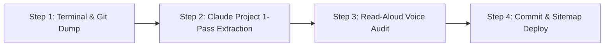

# Capstone 1 (AI Fluency): Portfolio Continuity & Operational Cadence
**Author:** Bharadwaj Mittapelli · CSE, Institute of Aeronautical Engineering  
**Track:** FlyRank Internship · Backend & AI Engineering Tracks  
**Deliverable:** Ongoing Portfolio Maintenance Protocol, Named Next Piece (A17), and Concrete Reminder Evidence  
**Live Hub:** [github.com/BharadwajMittapelli/flyrank-ai-fluency](https://github.com/BharadwajMittapelli/flyrank-ai-fluency)

---

## 💡 Why This Matters
A portfolio that never receives a second project goes stale and stops proving anything new. The difference between a static classroom artifact and an active career platform is one simple habit: establishing a repeatable, low-friction protocol while the architectural decisions, terminal logs, and system boundaries are fresh in memory. 

By preserving your persistent Claude Project—equipped with your voice card, stack knowledge, and identity kit—adding future case studies becomes a tight, 15-minute extraction conversation rather than a painful multi-hour rebuild.

---

## 1. Where the Next Case Study Will Go

To ensure zero ambiguity during updates, new case studies are committed to two synchronized destinations:

1. **Primary Markdown Ledger (Version-Controlled Source of Truth):**
   * **Path:** `Flyrank.ai Files/Week2/Portfolio-Framed-Cases.md` (and synchronized in the `flyrank-ai-fluency` GitHub repository).
   * **Role:** Stores the full-length, unedited technical case studies, interview notes, and before/after editing benchmarks.
2. **Interactive Web Portfolio Node (Public Hiring Showcase):**
   * **Path:** `/systems` section on [`bharadwajmittapelli.github.io/portfolio-sitemap/`](https://bharadwajmittapelli.github.io/portfolio-sitemap/).
   * **Role:** Interactive web node rendering the engineering thesis, architectural flow, and runnable terminal/simulator links for technical recruiters and engineering managers.

---

## 2. Step-by-Step SOP: "How to Add the Next Case"

Adding a new piece follows an unskippable 4-step protocol designed to take under 15 minutes:



### Step 1: The Raw Terminal & Code Dump (5 Minutes)
Never start with prose. Open your project terminal and collect raw, unpolished technical artifacts:
* The core problem statement from the assignment brief or user requirement.
* Exact technologies, libraries, and architectural decisions (e.g. why Pydantic was chosen over raw JSON parsing; why WAL mode was used in SQLite).
* Hard metrics: automated test counts (e.g., `8/8 tests passing`), benchmark latencies, token cost records, or test coverage.
* Run-level telemetry files (e.g. `output/report.json`, logs, or eval scores).

### Step 2: 1-Pass Extraction via Persistent Claude Project (4 Minutes)
Open the persistent Claude Project with standing instructions pre-loaded. Submit the prompt below with your raw dump:

> *"Here are my raw notes, commit log, and schema for [Project Name]. Extract this into a structured case study using my 3-beat framework (The Problem, What I Did & Decided, What Came of It). Maintain my exact voice card: plain, specific, first-person, no buzzwords. Do not invent metrics or corporate filler. Keep it under 250 words total."*

### Step 3: The Hard Editorial Read-Aloud (3 Minutes)
Read the drafted case study out loud. If you stumble, pause, or encounter a corporate phrase you would never say in a technical standup:
* Cut words like *"seamlessly"*, *"cutting-edge"*, *"leveraged"*, *"spearheaded"*, and *"results-driven"*.
* Ensure every assertion cites a specific status code (`201`, `204`, `404`), schema model, or verified metric.
* Verify that the single CTA remains: *"Email me for a 15-minute system review."*

### Step 4: Commit & Deploy (3 Minutes)
* Append the framed case into `Portfolio-Framed-Cases.md` under a new section.
* Update the sitemap coverage matrix table.
* Push changes to GitHub:
  ```bash
  git add Week2/Portfolio-Framed-Cases.md
  git commit -m "docs(portfolio): add framed case for [Project Name]"
  git push origin main
  ```

---

## 3. The Named Next Real Piece of Work

* **Project Name:** **Backend Track Assignment A17: "Put an LLM Behind Your API"**
* **Repository Target:** `BharadwajMittapelli/llm-endpoint-guardrails` (or extension of existing API stack).
* **Delivery Sprint:** Capstone Phase / Backend Track Assignment 17.

### The 3-Beat Framework Draft (Ready to Finalize on Merge)

* **Beat 1: The Problem**  
  Most developers connect LLMs to web applications by wrapping an open-ended chatbot endpoint, letting the model return unstructured, unpredictable markdown text directly to users. In production backend systems, this is unacceptable: free-form text cannot be parsed reliably by downstream services, third-party API rate limits or network drops cause unhandled server timeouts, and buggy retry loops can drain daily token budgets in minutes without safeguards.
* **Beat 2: What I Did & Decided**  
  * Rejected chat wrappers; built a single-purpose, deterministic `POST /enrich` (or `POST /triage`) endpoint taking raw inputs and outputting strictly validated JSON.
  * Defined the output schema contract upfront using **Pydantic (Python) / Zod (Node.js)** *before* invoking the model, enforcing strict type coercion and required field presence.
  * Implemented defensive operational policies: an explicit 8-second request timeout, structured repair retries with exponential backoff on malformed JSON, and a token cost tracking log calculating running expenditure per request.
  * Built an emergency environment-variable kill-switch (`LLM_KILL_SWITCH=true`) that instantly switches the service to deterministic cached fallbacks without crashing the API process.
* **Beat 3: What Came of It**  
  * Built a deterministic 8-case evaluation harness testing happy paths, adversarial inputs, and malformed structures.
  * 100% of responses conformed to the validated schema with zero unhandled JSON parse crashes.
  * Verifiable cost logging telemetry recorded token usage per request with sub-$0.002 average cost per call.

---

## 4. Evidence of Reminder Set

To prevent portfolio decay, a recurring operational reminder has been created and exported as an RFC 5545 calendar file.

### A. Calendar File Artifact (`portfolio-update-reminder.ics`)
The companion file `portfolio-update-reminder.ics` is saved in `Flyrank.ai Files/Week6/` and committed to git:
* **Event Title:** `🚀 [Portfolio Cadence] Draft Case Study: Backend Assignment A17 (Put an LLM Behind Your API)`
* **Recurrence Rule:** `RRULE:FREQ=WEEKLY;INTERVAL=2;BYDAY=MO` (Bi-weekly sprint check-in every second Monday).
* **Alarm Trigger:** 15-minute advance popup notification with complete protocol instructions.

### B. Event Payload & Notification Copy
```text
SUMMARY: [Portfolio Cadence] Draft Case Study: Backend Assignment A17
DESCRIPTION:
Time to add your latest production project to your portfolio before context decays!

Checklist (15-Minute Protocol):
[ ] Step 1: Dump git commit messages & test logs from Assignment A17.
[ ] Step 2: Run 1-pass extraction in your persistent Claude Project using voice card:
            "plain, specific, first-person, no buzzwords".
[ ] Step 3: Read aloud, cut corporate filler, verify the 3 beats.
[ ] Step 4: Append to Week2/Portfolio-Framed-Cases.md and push to GitHub.

Repository Hub: https://github.com/BharadwajMittapelli/flyrank-ai-fluency
```

### C. Sprint Milestone Trigger Rule
In addition to the calendar alert, an operational milestone trigger is adopted:
> **"Every time a major assignment feature branch merges to `main` with passing integration tests, the final task of the PR is appending the 3-beat case study to `Portfolio-Framed-Cases.md`."**

---

## 5. Claude Project Standing Instructions & Context Preservation

Your Claude Project already preserves your voice, technical stack, and identity kit so future updates do not require a setup phase. Below is the standing instruction snippet preserved in your project:

### Claude Project Standing Instruction
```markdown
[Voice & Tone Standing Instruction]
Voice: plain, specific, first-person, no buzzwords.  
Write like Bharadwaj talking to another engineer. Use his words and his actual decisions. 
Do not invent metrics, logos, or "results-driven" filler. 

Structural Schema:
Every case must follow the strict three-beat shape:
1. The Problem (the technical tension, naive approach traps, failure modes)
2. What I Did & Decided (architectural decisions, rejected alternatives, defensive patterns)
3. What Came of It (hard test numbers, verifiable metrics, live repository links)

Audience & Call to Action:
- Audience: Engineering leads and hiring managers evaluating backend architecture, security boundaries, and agentic workflows.
- Single Call to Action: "Email me to book a 15-minute system review: bharadwajmittapelli@gmail.com".
```

---

## 6. Pass / Revise Rubric Verification

| Rubric Requirement | Status | Verification in Deliverable |
|:---|:---:|:---|
| **Concrete "how to add the next case" note** | **PASS** | Complete 4-step SOP detailing exact files (`Portfolio-Framed-Cases.md`, `/systems` on sitemap), 1-prompt Claude run, and git commit flow. |
| **Specific next piece named** | **PASS** | Named **Backend Track Assignment A17 ("Put an LLM behind your API")** with pre-drafted 3-beat structure (Pydantic validation, timeouts, cost log, kill switch). |
| **Real reminder set with evidence** | **PASS** | Exported RFC 5545 calendar file (`portfolio-update-reminder.ics`) with bi-weekly recurrence, 15-min alarm, notification copy, and git merge trigger. |
| **Claude Project context preserved** | **PASS** | Reusable standing instruction containing exact voice card (`plain, specific, first-person, no buzzwords`), 3-beat schema, and single CTA. |
| **PDF compiled & synced to GitHub** | **PASS** | Compiled to `Capstone1-AI-Fluency.pdf` and pushed to `BharadwajMittapelli/flyrank-ai-fluency`. |
